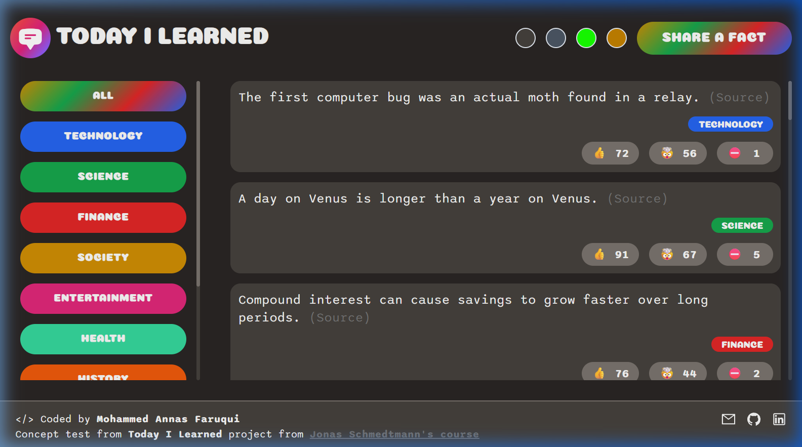
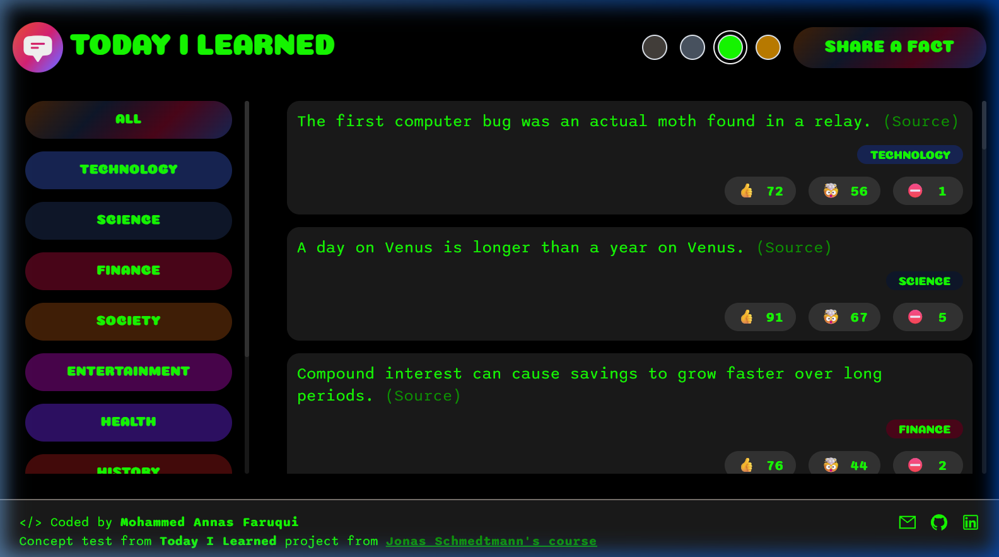
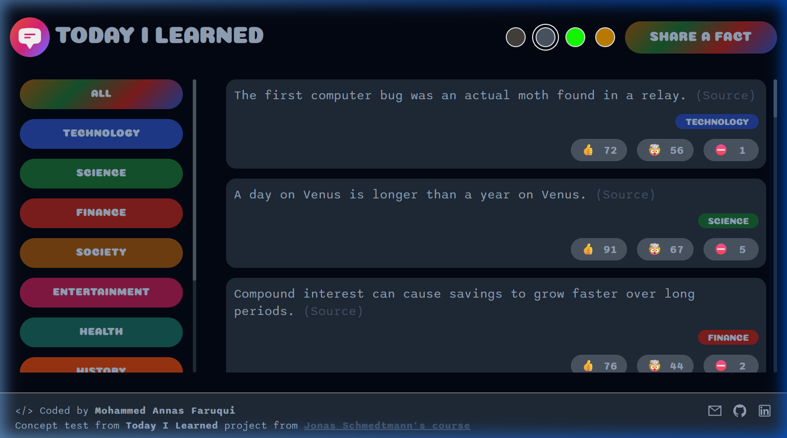
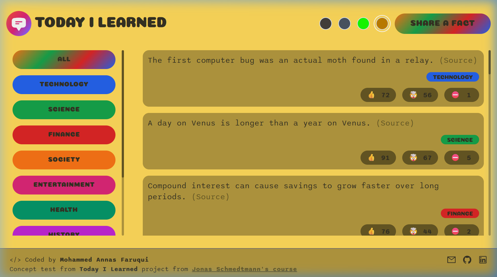

# 💡 Today I Learned (TIL)

A modern, responsive, and interactive web application where users can discover, post, and vote on interesting facts across various categories (Technology, Science, Finance, Society, Entertainment, Health, and more).

> **Live Demo:** [today-i-learned-annasfaruqui.netlify.app](https://today-i-learned-annasfaruqui.netlify.app)

---

## 📌 Project Overview & Purpose

This project is created as a **hands-on practice portfolio project** to build a modern React application with custom state management, theme switching, interactive voting, and seamless data persistence.

### 🎓 Origin & Credit

The core concept of this project originates from **Jonas Schmedtmann's** course:

- **Course:** [Build a Full-Stack App in a Weekend with React and Supabase](https://www.udemy.com/course/full-stack-crash-course)
- Huge credit and thanks to **Jonas Schmedtmann** for the inspiring tutorial and initial foundation!

---

## ✨ Enhancements & Custom Features

While inspired by the original course project, several major enhancements and customizations were implemented:

1. **Custom Styling & Dynamic Color Themes:**

   - Designed a completely custom aesthetic with Tailwind CSS, custom fonts (`Coiny` and `Sono`), and modern UI design.
   - Built a dynamic **Theme Switcher** featuring **4 color themes** stored in localStorage:
     - 🔵 **Default Theme** (Sleek dark theme with vibrant accents)
     - ⚪ **Faded Theme** (Low-contrast, relaxed slate theme)
     - 🟢 **Neon Theme** (Cyberpunk-inspired high-contrast neon theme)
     - 🟡 **Gold Theme** (Warm, energetic golden aesthetic)

2. **In-Codebase JSON Storage (Supabase Migration):**

   - The application was originally designed with a Supabase cloud database backend.
   - **Why migrate to in-codebase storage?**
     - **Geographical restrictions** on Supabase in certain regions.
     - **Free-tier maintenance hassle:** Supabase free tier pauses projects after 7 days of inactivity, requiring manual intervention to unpause.
     - For a learning and portfolio project, storing facts directly in an in-codebase JSON file (`src/data/facts.json`) via a Vite API plugin provides total autonomy, instant startup, zero external downtime, and reliable offline/local reproducibility.
   - Built a custom **Vite API middleware** (`plugins/vite-facts-api-plugin.js`) that supports `GET`, `POST`, `PATCH`, and `POST /reset` endpoints reading and writing atomically directly to `src/data/facts.json`, backed by a browser `localStorage` fallback layer for static deployments.

3. **Polished Voting & Loading Experience:**

   - Interactive voting with 👍 (Interesting), 🤯 (Mind-blowing), and ⛔ (False/Disputed) buttons.
   - Fact voting features a smooth, circular loading spinner without layout shifts.
   - Automatically marks a fact as `[DISPUTED]` when false votes exceed positive votes.

4. **Fact Submission & Validation:**
   - Expandable form with live character countdown (200 characters max).
   - Validation ensuring non-empty inputs and valid sources.

---

## 🎨 Color Themes Showcase

### 🔵 Default Theme



### 🟢 Neon Theme



### ⚪ Faded Theme



### 🟡 Gold Theme



---

## 🛠️ Tech Stack

- **Frontend:** [React 18](https://react.dev/), [Vite](https://vitejs.dev/)
- **Styling:** [Tailwind CSS](https://tailwindcss.com/), Custom CSS variables
- **Icons & Notifications:** [React Icons](https://react-icons.github.io/react-icons/), [React Hot Toast](https://react-hot-toast.com/)
- **Data Persistence:** Local `src/data/facts.json` via Vite dev server Connect middleware + LocalStorage fallback
- **Fonts:** Coiny, Sono

---

## 🚀 Getting Started & Local Setup

To run this project on your local machine, follow these steps:

### 1. Clone the repository

```bash
git clone https://github.com/annasfaruqui/today-i-learned.git
cd today-i-learned
```

### 2. Install dependencies

```bash
npm install
```

### 3. Start the development server

```bash
npm run dev
```

Open [http://localhost:5173](http://localhost:5173) in your browser. All additions and votes will persist directly to `src/data/facts.json` on disk!

### 4. Build for production

```bash
npm run build
```

To preview the production build locally:

```bash
npm run preview
```

### 5. Lint code

```bash
npm run lint
```
